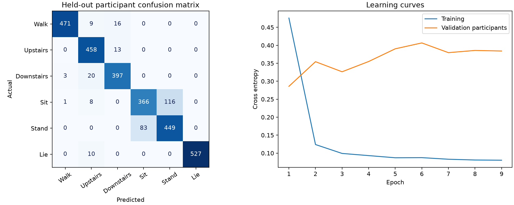

# MotionSense

[](https://github.com/Aidan-Arakkal/motionsense/actions/workflows/tests.yml)
[](LICENSE)

[Model card](MODEL_CARD.md) · [Data card](DATA_CARD.md) · [Evaluation results](artifacts/metrics.json)

**A neural activity recognition service with participant-independent evaluation.**

MotionSense classifies 2.56-second smartphone sensor windows into six activities.
It includes a trained PyTorch temporal CNN, a classical baseline, temperature
scaling, a FastAPI inference service, an interactive signal explorer, and tests.

The engineering question: **can a model recognize activities for people it has
never seen, and can its confidence be trusted on those people?**

## Measured results

One deterministic seed-42 CPU experiment on the official UCI HAR test split:

| Measure | Result |
|---|---:|
| CNN accuracy | **90.53%** |
| CNN macro F1 | **0.9059** |
| Logistic regression accuracy | 83.81% |
| Accuracy improvement | 6.72 percentage points |
| Test population | 2,947 windows / 9 unseen participants |
| Model parameters | 240,486 |
| Batch-one model-only CPU latency, p50 / p95 | 0.35 / 0.63 ms |
| Participant-bootstrap 95% accuracy interval | 83.94%–95.43% |

Latency uses 200 timed forwards after 25 warmups, four CPU threads, on the host
recorded in `artifacts/metrics.json`. It excludes normalization, HTTP, JSON, and
the 2.56-second sensor acquisition window. It is not a deployment SLA.

**A result worth discussing:** temperature scaling reduced calibration-set NLL
from 0.0564 to 0.0377, but increased test NLL from 0.2403 to 0.3769 and test ECE
from 0.0315 to 0.0640. Calibration did not transfer reliably across participants.
The demo exposes the calibrated probabilities for inspection, without claiming
that they are reliable in deployment. See [MODEL_CARD.md](MODEL_CARD.md).



## Run the included model

Python 3.11+; the measured environment used Python 3.13.2. No GPU, API key, or
dataset download is needed to run the included demo.

```powershell
python -m venv .venv
.venv\Scripts\Activate.ps1
python -m pip install torch --index-url https://download.pytorch.org/whl/cpu
python -m pip install -e ".[dev]"
python -m uvicorn motionsense.api:app --host 127.0.0.1 --port 8000
```

On macOS/Linux, activate with `source .venv/bin/activate`. Open
[localhost:8000](http://localhost:8000) for the demo, or
[localhost:8000/docs](http://localhost:8000/docs) for interactive API documentation.

The demo replays one real held-out window per activity. Ground truth is shown
alongside predictions, including mistakes. It does not read live phone sensors.

## Train and reproduce

```bash
python -m motionsense.train --epochs 35 --seed 42
python -m pytest -q
```

Training downloads approximately 58 MB from the original UCI source, checks the
archive SHA-256, and caches signal tensors under `data/`. The official training
participants are split into **14 train / 4 validation / 3 calibration** participants;
the official nine test participants remain held out. The scaler sees only training
windows. A validation-loss early-stop rule selects the checkpoint (epoch 1 in the
included run), and independent calibration participants fit the temperature.

The epoch limit is 35 with patience 8; the included run stopped at epoch 9. No
architecture or hyperparameter search was conducted against the test set. The
baseline uses 45 summary features from the same nine signal channels, trains on
the same participants, and uses fixed hyperparameters. It is one modest baseline,
not a comparison to state-of-the-art HAR methods or UCI's full 561-feature models.

Use `--output artifacts/experiment-02` for a new experiment without overwriting
the shipped checkpoint. Set `MOTIONSENSE_ARTIFACT_DIR` to serve another artifact
directory. `requirements-reproduce.txt` records exact direct dependency versions
from the measured run; install the matching CPU torch version first, then that
file. It is not a fully resolved cross-platform lockfile. Exact timing and numeric
results can vary by hardware or library version. Seeds, split IDs, model and data
hashes, environment, metrics, and learning curves are saved with each run.

## Inference API

```python
import requests

base = "http://127.0.0.1:8000"
example = requests.get(f"{base}/examples").json()[0]
response = requests.post(f"{base}/predict", json={"window": example["window"]})
response.raise_for_status()
print(response.json())
```

`POST /predict` accepts **128 rows × 9 columns** of finite sensor values. The channel
order and units are available at `/schema`. Inputs are UCI-filtered signals, not
arbitrary raw accelerometer readings. The response includes a prediction,
temperature-scaled probabilities, confidence, a model version, and a review flag
below a predeclared 0.80 confidence threshold. That threshold is a demonstration
policy; it is not a risk guarantee. `/health` reports readiness and model hash;
`/metrics` returns the recorded experiment.

## Architecture

```text
UCI 9 × 128 windows → training-only channel normalization
  → Conv1D(9→32, k=5) / BatchNorm / ReLU / MaxPool
  → Conv1D(32→64, k=5) / BatchNorm / ReLU / MaxPool
  → Conv1D(64→96, k=5) / BatchNorm / ReLU / MaxPool
  → Flatten / Dropout / Linear(1536→128) / ReLU / Dropout
  → Linear(128→6) → temperature scaling → probabilities + review flag
```

## Engineering checks

Tests cover participant separation, channel normalization, network gradients,
temperature fitting, malformed API requests, checkpoint/served prediction parity,
and normalized probabilities. GitHub Actions runs the suite on pushes and PRs.
The supplied checkpoint allows artifact integration tests without training in CI.

A Docker recipe is included:

```bash
docker build -t motionsense .
docker run --rm -p 127.0.0.1:8000:8000 motionsense
```

The Docker recipe and GitHub Actions configuration are supplied but were not
executed in the authoring environment. Local Python training, inference, and tests
are the verified path. Public hosting would additionally need authentication,
request size/rate limits, observability, and an operational deployment plan.

## Repository guide

| Path | Purpose |
|---|---|
| `motionsense/data.py` | Source download, integrity check, participant splits |
| `motionsense/model.py` | PyTorch CNN and temperature scaling |
| `motionsense/train.py` | Training, baseline, evaluation, export |
| `motionsense/inference.py` | Shared checkpoint inference path |
| `motionsense/api.py` | API, input schema, readiness |
| `motionsense/static/index.html` | Interactive demo |
| `artifacts/` | Trained weights, evaluation, learning history, examples |
| `tests/` | Unit and artifact integration checks |
| `DATA_CARD.md` / `MODEL_CARD.md` | Provenance, scope, limitations |
| `PORTFOLIO.md` | Resume bullets, demo script, interview preparation |

## Data attribution

Reyes-Ortiz, J., Anguita, D., Ghio, A., Oneto, L., & Parra, X. (2013).
*Human Activity Recognition Using Smartphones* [Dataset]. UCI Machine Learning
Repository. [doi:10.24432/C54S4K](https://doi.org/10.24432/C54S4K). CC BY 4.0.
Training code transforms the original filtered signal windows into channel-first
tensors. Included examples are transposed copies of six official test windows.
See [DATA_CARD.md](DATA_CARD.md) for additional context.
